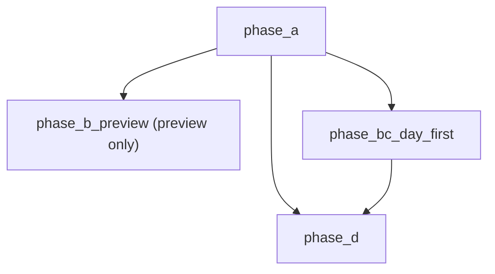

# Pipeline graph (generated)

> Generated by `python -m gomoveshift.pipeline.graph_doc` from the live
> `STAGE_ORDER` and `PHASE_SPECS` tables. Do not edit by hand — regenerate.
> Pinned by `tests/test_pipeline_graph_doc.py` (committed == generated).

## Long-form stages (STAGE_ORDER), grouped by sub-pipeline

```mermaid
flowchart TD
    subgraph ingest_and_prep
        s_validation["0 validation"]
        s_analytics_sync["1 analytics_sync"]
        s_detect_properties["2 detect_properties"]
        s_copy_to_wsl["3 copy_to_wsl"]
    end
    subgraph light_metadata
        s_stop_removal["4 stop_removal"]
        s_blur_detection["5 blur_detection"]
        s_chapter_generation["6 chapter_generation"]
        s_metadata_generation["7 metadata_generation"]
        s_schedule_generation["8 schedule_generation"]
        s_pre_render_review["9 pre_render_review"]
    end
    subgraph render_and_derive
        s_single_pass_encode["10 single_pass_encode"]
        s_thumbnail_generation["11 thumbnail_generation"]
        s_shorts_analysis["12 shorts_analysis"]
        s_social_generation["13 social_generation"]
    end
    subgraph publish_and_archive
        s_validation_gate["14 validation_gate"]
        s_drive_upload["15 drive_upload"]
        s_csv_generation["16 csv_generation"]
        s_d_drive_copy["17 d_drive_copy"]
        s_cleanup["18 cleanup"]
    end
    s_validation --> s_analytics_sync
    s_analytics_sync --> s_detect_properties
    s_detect_properties --> s_copy_to_wsl
    s_copy_to_wsl --> s_stop_removal
    s_stop_removal --> s_blur_detection
    s_blur_detection --> s_chapter_generation
    s_chapter_generation --> s_metadata_generation
    s_metadata_generation --> s_schedule_generation
    s_schedule_generation --> s_pre_render_review
    s_pre_render_review --> s_single_pass_encode
    s_single_pass_encode --> s_thumbnail_generation
    s_thumbnail_generation --> s_shorts_analysis
    s_shorts_analysis --> s_social_generation
    s_social_generation --> s_validation_gate
    s_validation_gate --> s_drive_upload
    s_drive_upload --> s_csv_generation
    s_csv_generation --> s_d_drive_copy
    s_d_drive_copy --> s_cleanup
```

## Drive phases (PHASE_SPECS)

